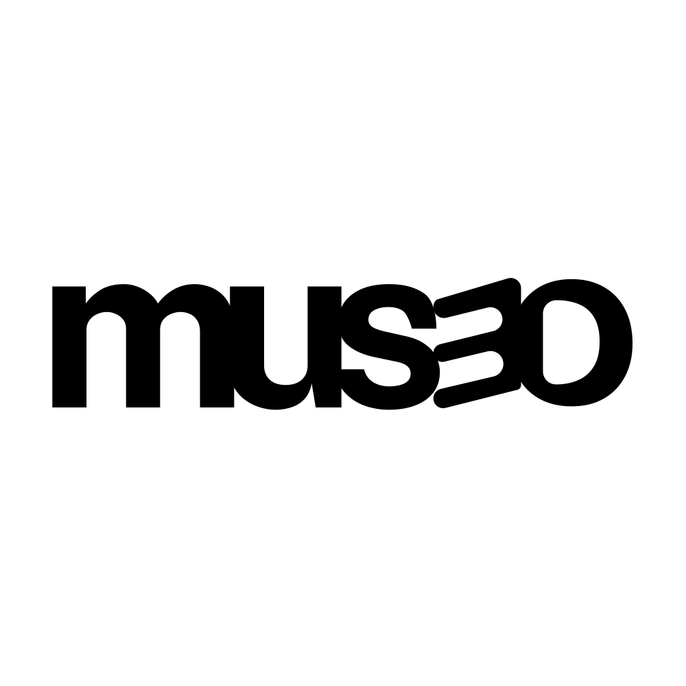

# mus3o · team-5

  



**Platanus Hack 26: Caracas ft. Yummy Project**

## Qué es

mus3o convierte tus apuntes de estudio en un palacio de la memoria 3D que recorres en primera persona. Cada tema es una sala, cada concepto es una pieza con su objeto 3D, y un repaso espaciado te dice qué está por olvidarse.

## Equipo

**Mentor:** Anthony Nardelli

| Miembro | GitHub |
|---|---|
| Daniel Bruno | [@holeekey](https://github.com/holeekey) |
| Jesus Rodolfo Gil Farias | [@jrgil20](https://github.com/jrgil20) |
| Valeria Riera | [@ingvaleriariera](https://github.com/ingvaleriariera) |
| Massiel Paola Perozo Ballestero | [@massiperozo](https://github.com/massiperozo) |
| Gabriel Castellano | [@gdcastellano](https://github.com/gdcastellano) |

## Evento

- **Fecha:** viernes 23 de octubre de 2026, 17:00 → domingo 25 de octubre de 2026, 15:00 (46 horas).
- **Lugar:** Edificio Centro Banaven (Cubo Negro), Torre A, piso 7. Avenida La Estancia, Urbanización Chuao, Caracas, Venezuela.

## Cómo correr

```bash
cp .env.example .env     # añade ANTHROPIC_API_KEY (sin ella: mock para temas, apuntes sin IA)
npm install
npm run dev              # web en :5173, server en :3001
```

Demos rápidas: `?demo`, `?demo=ia`, `?demo=historia`, `?demo=medicina`, `?demo=dungeon`, `?demo=compuesto` (salas sin diorama: cada una recibe uno compuesto por `diorama/compose.ts`; con `?dioramas=library` se desactiva la composición).

## Documentación

Toda la documentación técnica está en [`docs/`](./docs/README.md): arquitectura, contrato de datos, servidor, frontend, memoria y examen, diorama, fuentes e imágenes, estado y pendientes, y guía de desarrollo.

## Estado del envío

- [ ] Nombre, one-liner, descripción y deploy URL en `platanus-hack-project.jsonc`
- [ ] `project-description.md` con la descripción real
- [ ] Logo `project-logo.png` de 1000×1000 y máximo 500 KB (sin verificar)
- [x] README
- [ ] Deploy funcionando desde el repo personal espejo

## Deploy e integraciones

Deploy platforms like **Vercel**, **Render** or **Netlify** can only connect to repositories **you own**. To deploy while keeping commits in this org repo:

1. Create a **personal** repository on your GitHub account.
2. Point your local `origin` at **both** repos, so one `git push` updates each:

   ```bash
   git remote set-url --add --push origin https://github.com/platanus-hack/platanus-hack-26-ve-team-5.git
   git remote set-url --add --push origin https://github.com/<your-user>/<your-repo>.git
   ```

3. Connect your deploy service to your **personal** repo and deploy from there.

## Assets y atribución

- **KayKit Dungeon Asset Pack (1.1)**: creado por **Kay Lousberg** ([www.kaylousberg.com](https://www.kaylousberg.com)), licencia [CC0](https://creativecommons.org/publicdomain/zero/1.0/).
- Modelos, texturas y fuentes van con **Git LFS**. Detalle completo en [ASSETS.md](./ASSETS.md).

Have fun! 🚀
