# Plan de Optimización en 4 Capas para Dioramas ("Mundo Vivo")

**Proyecto:** mus3o — Palacios de la Memoria 3D  
**Rama:** `feature/diorama-semantic-dsl`  
**Fecha:** 24 de Octubre, 2026 (revisado tras análisis de viabilidad)  
**Estado:** Fases 1 a 3 implementadas (parser, hidratación en el cliente, prompt y servidor), sin zonas avanzadas (Fase 4) y con la medición real pendiente (Fase 0). La línea base de `docs/servidor.md` (3 365 tokens, 27 s, 1 diorama) es una medición real de la arquitectura anterior. Los dioramas con Haiku se descartaron allí con el JSON; con micro-DSL habría que repetir la prueba antes de usarlo en Aris.

> **Sobre las cifras.** Los conteos de tokens de este documento son **estimaciones por inspección de código, no
> mediciones**. Los costos usan los precios vigentes de los modelos que el código realmente usa (sección 4). Antes
> de implementar, hay que sacar la línea base real con el log `tokens (diorama): ...` de `claude.ts` (sección 6).

---

## 1. Resumen Ejecutivo y Diagnóstico

El flujo principal del museo (`/api/generate-museum`) usa un pipeline DSL de pocos tokens para salas y piezas.
Cuando el modelo marca una sala como `diorama` (máximo 2, `dsl.ts:259` y `:378`), el servidor ejecuta una
**segunda llamada HTTP** en `apps/server/src/claude.ts:250` (`addDioramas`):

1. **Contexto reenviado:** se envía otra vez un system prompt (`DIORAMA_SYSTEM_PROMPT`, con `DIORAMA_RULES`, que es largo) y la lista de salas. Ese prompt ya va con `cache_control: ephemeral`, así que parte de la entrada se paga como lectura de caché.
2. **JSON con números flotantes:** se pide un objeto por sala con 8 a 16 props, cada uno con `pos`, `rotY`, `scale` y colores hex. Estimación: **1.500 a 3.000 tokens de salida** (`max_tokens: 4000`).
3. **Latencia añadida:** la llamada espera a que termine el DSL principal y corre con timeout de 60 s. Corre en paralelo solo con `resolveModels` (`completeMuseum`, `claude.ts:318`), no con la llamada principal.
4. **Compositor sin aprovechar:** `apps/web/src/diorama/compose.ts` ya compone dioramas de forma determinista y sin costo (`composeDiorama`, `attachComposedDioramas`), y `store.ts:127` lo aplica a toda sala sin diorama.

El modelo por defecto es `claude-sonnet-5-5` (`claude.ts:50`; el diorama usa `ANTHROPIC_DIORAMA_MODEL` o el principal, `:55`).

Este plan articula 4 capas: la IA actúa como **director de arte semántico**, `compose.ts` resuelve la geometría, y la directiva viaja dentro de la llamada principal.

---

## 2. Análisis de Factibilidad por Capa

```mermaid
flowchart TD
    subgraph Actual["Flujo actual (2 llamadas)"]
        A1["Cliente pide museo"] --> B1["Llamada 1: Sonnet 5.5 (DSL salas)"]
        B1 --> C1["parseMus3oDSL detecta 'diorama'"]
        C1 --> D1["Llamada 2: Sonnet 5.5 (JSON de props)"]
        D1 --> E1["parseDiorama valida JSON"]
        E1 --> F1["Cliente 3D"]
    end

    subgraph Optimizado["Flujo propuesto (1 llamada)"]
        A2["Cliente pide museo"] --> B2["Única llamada: Sonnet 5.5 (DSL + micro-DSL)"]
        B2 --> C2["Líneas DIO y D_PROP"]
        C2 --> D2["Cliente: compose.ts hidrata coordenadas y colisiones"]
        D2 --> E2["Diorama final validado con DioramaSchema"]
        E2 --> F2["Escena 3D"]
    end
```



### Capa 1: Separar semántica (LLM) de geometría (`compose.ts`)

- **Veredicto:** viable, con más trabajo del que parece.
- **Diagnóstico:** el modelo es poco fiable con coordenadas continuas. Pedir `pos: [x, z]` produce props fuera de lugar o colisionando, y gasta tokens.
- **Qué hace el LLM:** elige arquetipo, hora y zonas relativas (`center`, `front`, `flanks`, `background`, `path`).
- **Qué hace `compose.ts`:** asigna `pos`, `rotY`, `scale` y paleta.
- **Realidad del código que condiciona el diseño:**
  - Hoy `compose.ts` solo tiene `arcSlots(n)` (abanico para piezas enlazadas) y `navalSlots`. **No existen zonas semánticas**: interpretar `center/front/background/path` es diseño nuevo, no una exposición de algo existente.
  - `compose.ts` importa `./terrain` (`heightField`, `shoreZ`), que depende de THREE, además de `./library` y `./random`. **No se puede mover tal cual a `@mus3o/shared`** ni usar en el servidor.
- **Decisión:** **hidratar en el cliente.** El servidor solo transporta las directivas (campo `directives` de la sala) y el cliente llama a `hydrateDioramaFromDirectives`, de la misma forma que `attachComposedDioramas` ya corre en `store.ts`. No se mueve ningún módulo.
  - Alternativa descartada por ahora: mover a `shared` lo que no depende de THREE (`random`, `arcSlots`, clasificación) e hidratar en el servidor. Solo conviene si se necesita un museo ya hidratado en la caché de disco.
- **Primera iteración sin zonas:** reutilizar `arcSlots` para los props enlazados a piezas y `ambientFor` para el ambiente. Las zonas se añaden después, si la calidad lo pide.

### Capa 2: Micro-DSL semántico

- **Veredicto:** viable, pero la gramática original **pierde expresividad** del esquema actual.
- **Gramática propuesta (ampliada):**
  ```text
  DIO: battle | sunset | historic | 4821
  D_PROP: center | monument | idle | 1 | p1 | Tratado de Paz
  D_PROP: front | rider | charging | 6 | p2 | Carga de Páez | #2b4c94
  D_PROP: background | flag | drift | 8 | p3 | Estandartes | #ffffff #a8322d saltire
  ```
  Campos: `zona | kind | pose | count | pieceId | label` y, opcionalmente, `color`, `secondary` y `pattern`.
- **Qué NO cubre la gramática y cómo se resuelve:**

  | Capacidad actual de `DioramaPropSchema` | Tratamiento |
  |---|---|
  | `color`, `secondary`, `pattern` (banderas, p. ej. Cruz de Borgoña) | Campos opcionales al final de `D_PROP` |
  | `terrain` (`river`, `coast`, `mountains`...) | Campo opcional en `DIO`; si falta, se deriva del arquetipo como hace `compose.ts` |
  | Terrenos científicos `organic`, `cellular`, `vessel` y su kit (`nucleus`, `blood-cell` con `flow`, `valveType`...) | **Fuera del micro-DSL en esta fase.** Estas salas siguen por el camino JSON actual (`addDioramas`) hasta que exista un equivalente |
  | `parts` (props `custom`) y `y` | Fuera de alcance; solo vía JSON |

- **Estimación de tokens de salida del diorama:** JSON actual ~1.500 (≈120 por prop × 12). Micro-DSL ~12 a 20 por línea × 5 a 6 líneas = **~60 a 120**. Reducción estimada: **~92 a 96 %**. Es una estimación, no una medición.

### Capa 3: Fusión de llamadas

- **Veredicto:** viable y es la mejora más valiosa. Elimina un viaje de red completo y la espera al DSL principal.
- **Implementación:**
  1. `packages/shared/src/dsl.ts`: añadir `DIO` y `D_PROP` a `DslLineKind` y a `LINE_TAG`/`classifyDslLine` (`dsl.ts:150-158`). El parser de una sola vez y el incremental **comparten `DslAccumulator`**, así que ambos caminos las leen sin trabajo duplicado. Asociar las directivas a la sala en curso (`current`).
  2. `apps/server/src/prompts.ts`: reemplazar `DIORAMA_RULES` por la especificación del micro-DSL en `FLOW_DSL_SYSTEM_PROMPT`.
  3. Servidor, **dos puntos de entrada**: `claude.ts:302` (camino sin streaming) y `stream.ts:119` (streaming). Ambos llaman hoy a `completeMuseum(..., dioramaRooms)`.
  4. `addDioramas` se conserva **solo** para las salas con terreno científico (ver Capa 2) y como respaldo; sale del camino crítico del resto.
- **Riesgos de la fusión:**
  - Hoy un diorama roto no afecta al museo (llamada aparte, `maxRetries: 0`). Tras la fusión, una línea `D_PROP` malformada pasa por el parser principal. **Debe tolerarse**: descartar la línea inválida, nunca la sala ni el museo, igual que `DioramaSchema` descarta props inválidos.
  - Sube la salida de la llamada principal. Revisar `maxTokens` del flujo (`flowDslPrompt`) para evitar truncamientos.
  - Confirmar si el prompt entra en la clave de caché (`cache.ts:16` hashea la clave `k`; no se verificó qué la compone). Si la incluye, los museos cacheados con el prompt anterior no se reutilizan, lo cual es aceptable pero hay que saberlo.
- **Latencia:** se elimina la segunda llamada. El ahorro real es el tiempo de esa llamada (sin medir; ver sección 6).

### Capa 4: Modelo y fallback sin costo

- **Veredicto:** viable; gran parte ya existe.
- **Estrategia:**
  1. **Llamada fusionada:** modelo principal (`claude-sonnet-5-5`). El micro-DSL añade del orden de 100 tokens de salida.
  2. **Fallback sin costo:** si falta `DIO:` para una sala o no hay datos (demo/offline), actúa `attachComposedDioramas` (`compose.ts:665`), que ya rellena toda sala sin diorama. No requiere código nuevo.
  3. **Aris:** el endpoint "rediseña este diorama" usaría `ANTHROPIC_FALLBACK_MODEL` (`claude-haiku-5-5`) con `thinking: { type: "disabled" }` (`noThinking`, `claude.ts:59`). **Coordinar con `feature/aris-haiku-fallback`**, que ya cablea Haiku, para no duplicar.

---

## 3. Matriz de Componentes a Modificar

| Archivo / Módulo | Estado actual | Qué se modifica |
|---|---|---|
| `packages/shared/src/dsl.ts` | Reconoce `ROOM`, `PIECE`, `TITLE`, `PERIOD`, `QUIZ`, `IMAGE`; marca salas `diorama` | Añadir `DIO` y `D_PROP` a `DslLineKind`/`classifyDslLine`; acumular directivas en la sala; tolerar líneas inválidas |
| `packages/shared/src/schema.ts` | `DioramaSchema` completo (24 props máx., `KINDS`, `POSES`) | Dejar `DioramaSchema` intacto. Añadir un esquema ligero `DioramaDirectiveSchema` y el campo opcional `directives` en la sala |
| `apps/web/src/diorama/compose.ts` | `composeDiorama`, `attachComposedDioramas`, `arcSlots` | Añadir `hydrateDioramaFromDirectives(directives, room)`. **No se mueve a `shared`** (depende de THREE vía `terrain`) |
| `apps/web/src/store.ts` | Llama a `attachComposedDioramas` (`:127`) | Hidratar las directivas antes del relleno compuesto |
| `apps/server/src/prompts.ts` | `DIORAMA_RULES` pide JSON de 8 a 16 props | Especificación del micro-DSL en `FLOW_DSL_SYSTEM_PROMPT`; conservar las reglas JSON para terrenos científicos |
| `apps/server/src/claude.ts` | `addDioramas` como 2.ª llamada (`:250`), invocada desde `completeMuseum` (`:318`) | Limitar `addDioramas` a salas científicas/respaldo |
| `apps/server/src/stream.ts` | Llama `completeMuseum` con `parser.dioramaRooms` (`:119`) | Mismo ajuste que `claude.ts:302` |
| `apps/server/src/cache.ts` | Cachea el `Museum` en disco | Sin cambios de código; verificar qué compone la clave |

---

## 4. Impacto Financiero y de Rendimiento (estimado)

**Precios vigentes (USD por millón de tokens):**

| Modelo | Entrada | Salida | Lectura de caché |
|---|---|---|---|
| `claude-sonnet-5-5` | $2,00 | $10,00 | $0,20 |
| `claude-haiku-5-5` (prompts hasta 100K) | $0,10 | $0,50 | n/d |

**Cálculo solo de salida** (los tokens de entrada de la 2.ª llamada no están medidos y se excluyen):

| Métrica | Actual | Propuesto | Diferencia |
|---|---|---|---|
| Llamadas a Claude por museo con diorama | 2 | 1 | −1 llamada |
| Tokens de salida del diorama (estimado) | ~1.518 | ~75 a 120 | ~−92 a −95 % |
| Tokens de salida totales (estimado) | ~3.365 | ~1.920 a 1.970 | ~−41 a −43 % |
| Costo de salida del diorama | ~$0,0152 | ~$0,0008 a $0,0012 | ~−$0,014 |
| Costo de salida total del museo | ~$0,0337 | ~$0,0192 a $0,0197 | ~−$0,014 (≈ −42 %) |
| Costo por diorama con Aris (Haiku 5.5, ~100 tokens de salida y ~2.000 de entrada) | n/a | ~$0,0003 | — |
| Latencia | **sin medir** | **sin medir** | se quita una llamada completa |

Notas:
- Las cifras anteriores del documento ($0,0523 → $0,0298, 27 s → 13 s) usaban el precio de "Sonnet 3.5" ($15/MTok de salida), que no es el modelo del código, y tiempos sin fuente. Quedan **retiradas**.
- Con el precio correcto el ahorro absoluto por museo es de ~1,4 centavos de dólar, menor que el estimado antes. El beneficio dominante es la **latencia y la robustez**, no el costo.
- **Calidad visual:** la afirmación "cero pérdida" no se sostiene para banderas con patrón ni para dioramas científicos; por eso la Capa 2 añade campos opcionales y deja los terrenos científicos en el camino JSON.

---

## 5. Plan de Implementación (checklist)

Orden revisado: primero la fusión con hidratación mínima, que entrega casi todo el valor; las zonas semánticas van después.

### Fase 0: Línea base (medir antes de tocar)
- [x] (2 museos, 1 pareado; ver sección 6) Generar 5 museos de temas distintos con diorama y anotar del log `tokens (diorama): entrada X, salida Y, caché leída Z` y el tiempo de la llamada de diorama frente al total.
- [ ] Reemplazar las estimaciones de la sección 4 por esos números.

### Fase 1: Parser (`@mus3o/shared`)
- [x] Reconocer `DIO:` y `D_PROP:` en `packages/shared/src/dsl.ts` y acumularlas en la sala (vale para el parser de una pasada y el incremental).
- [x] Líneas inválidas: se descartan sin afectar la sala.
- [x] Pruebas en `packages/shared/src/dsl.test.ts`, incluida una entrada por el parser incremental.

### Fase 2: Hidratación en el cliente (`apps/web`)
- [x] Hidratación en `compose.ts` (`composeDiorama` con directivas + `attachDirectedDioramas`, en lugar de `hydrateDioramaFromDirectives`), primero con `arcSlots` y `ambientFor`, sin zonas.
- [x] Conectarla en `store.ts` antes de `attachComposedDioramas`.
- [x] Pruebas en `apps/web/src/diorama/compose.test.ts`: resultado válido según `DioramaSchema`, props enlazados con `pieceId` existente, sin solapes (`MIN_LINK_SPACING`).

### Fase 3: Prompts y servidor (`apps/server`)
- [x] Especificación del micro-DSL en `FLOW_DSL_SYSTEM_PROMPT` (`prompts.ts`).
- [x] Limitar `addDioramas` a salas científicas/respaldo, en `claude.ts:302` y `stream.ts:119`.
- [ ] Revisar `maxTokens` de la llamada principal.
- [ ] `npm run test -w @mus3o/server`.

### Fase 4: Zonas semánticas (opcional, si la calidad lo pide)
- [ ] Diseñar `center/front/flanks/background/path` sobre el compositor.

### Fase 5: Verificación
- [ ] `npm run typecheck`.
- [ ] `npm run dev` y revisión manual con `?demo=historia` (rótulos, colisiones, atmósfera) y con un tema científico, para comprobar que sigue por el camino JSON.
- [ ] Repetir la medición de la Fase 0 y actualizar la sección 4.

---

## 6. Medición real (2026-10-25, `claude-sonnet-5-5`, mismo tema en ambos)

Tema: "Revolución francesa: Bastilla, Asamblea Nacional y Terror" (5 salas). Salida de Claude, del log `tokens`:

| | Antes (JSON aparte) | Ahora (micro-DSL fusionado) |
|---|---|---|
| Llamada principal | 3.341 tokens | 3.514 tokens (+173 por las líneas `DIO`/`D_PROP`) |
| Llamada de diorama | 2.825 tokens | **no existe** (no aparece `tokens (diorama)`) |
| **Total de salida** | **6.166** | **3.514 (−43 %)** |
| Costo de salida a $10/MTok | ~$0,062 | ~$0,035 (−$0,027) |

- Un museo de Carabobo dio 6 props válidos (jinetes, infantería, bandera con color) en la sala con diorama; el modelo siguió el formato sin ayuda.
- La llamada de diorama de JSON gastó 2.825 tokens, más que los ~1.518 que estimaba el plan; el ahorro absoluto fue mayor.
- **Latencia: no concluyente.** 45,0 s antes y 40,9 s ahora, pero ambos dominados por `poly.pizza` bloqueado (403) y el respaldo de modelos en este entorno. Hay que repetirlo con red normal.
- **Navegador:** con Vite y Chromium headless, `enterPalace` con una sala con directivas dejó `time: night`, `rider` ×6 y `figure` enlazados a piezas, `cannon` ×2 y bandera `saltire`; el palacio renderiza sin errores de la app. No se recorrió a pie el cuadro portal.
- Muestra pequeña (2 museos nuevos, 1 pareado): sirve para confirmar el orden de magnitud, no para fijar porcentajes.

## 7. Qué falta por verificar

- Latencia con red normal (la medición de tokens ya está en la sección 6).
- Qué compone la clave de caché de `cache.ts`.
- Calidad visual del micro-DSL frente al JSON entrando al cuadro (portal) en un tema histórico.
