# Plan de Optimización en 4 Capas para Dioramas ("Mundo Vivo")

**Proyecto:** mus3o — Palacios de la Memoria 3D  
**Rama:** `feature/diorama-semantic-dsl`  
**Fecha:** 24 de Octubre, 2026  
**Estado:** Documento de Diseño y Análisis de Factibilidad Arquitectónica

---

## 1. Resumen Ejecutivo y Diagnóstico

Actualmente, el flujo principal del museo (`/api/generate-museum`) utiliza un pipeline Low-Token DSL eficiente para las salas y piezas. Sin embargo, cuando una sala activa un diorama inmersivo ("mundo vivo"), el servidor ejecuta una **segunda llamada HTTP separada** en [`apps/server/src/claude.ts:250-275`](file:///home/jr_g/Develop/platanus-hack-26-ve-team-5/apps/server/src/claude.ts#L250-L275) (`addDioramas`):
1. **Sobrecarga de Transporte y Contexto:** Se re-envía el system prompt y la lista de salas, pagando tokens de entrada redundantes.
2. **JSON Masivo con Números Flotantes:** Se pide a la IA un payload JSON con 8 a 16 props. Cada prop incluye coordenadas x/z, rotaciones, escalas y colores hexadecimales (`"pos": [-4.2, 8.15], "rotY": 1.57, "scale": 1.2`), consumiendo entre **1.500 y 3.000 tokens de salida**.
3. **Modelo Ineficiente:** Se ejecuta en Claude 3.5 Sonnet ($15.00 / MTok salida), costando **~$0.025 a $0.045 USD adicionales** y sumando ~15 segundos de latencia a la generación del museo.
4. **Desconexión con el Compositor Existente:** En el frontend ya existe un motor de composición procedural determinista ([`apps/web/src/diorama/compose.ts`](file:///home/jr_g/Develop/platanus-hack-26-ve-team-5/apps/web/src/diorama/compose.ts)) capaz de ubicar props, evitar colisiones y aplicar arquetipos a **costo cero absoluto**.

Este plan articula una solución en **4 capas** para que la IA actúe como **Director de Arte Semántico**, delegando la matemática espacial a `compose.ts` y fusionando la directiva dentro del flujo DSL principal sin llamadas HTTP extra.

---

## 2. Análisis de Factibilidad por Capa

```mermaid
flowchart TD
    subgraph Actual["Flujo Actual (2 Llamadas HTTP — 3.365 Tokens)"]
        A1["Cliente pide museo"] --> B1["Llamada 1: Claude Sonnet (DSL salas)"]
        B1 --> C1["parseMus3oDSL detecta 'diorama'"]
        C1 --> D1["Llamada 2: Claude Sonnet (JSON masivo 1.500+ tokens)"]
        D1 --> E1["parseDiorama valida JSON"]
        E1 --> F1["Cliente 3D (Latencia total: ~27s | Costo: ~$0.052 USD)"]
    end

    subgraph Optimizado["Flujo 4 Capas (1 Sola Llamada — 2.000 Tokens)"]
        A2["Cliente pide museo"] --> B2["Única llamada: Claude Sonnet (DSL + Micro-DSL)"]
        B2 --> C2["Líneas DIO y D_PROP (~70 tokens)"]
        C2 --> D2["Motor compose.ts calcula coordenadas, slots y colisiones"]
        D2 --> E2["Objeto Diorama final ensamblado deterministamente"]
        E2 --> F2["Cliente 3D (Latencia total: ~13s | Costo: ~$0.029 USD)"]
    end
```



---

### Capa 1: Desacoplar Semántica (LLM) de Geometría (`compose.ts`)
- **Veredicto de Factibilidad:** **100% Viable y Altamente Recomendada.**
- **Diagnóstico:** Los LLMs son probabilísticos y deficientes calculando números continuos en 3D. Pedirles `x: 12.4, z: -5.2` genera props flotando en el aire, colisiones contra obstáculos y un gasto innecesario de tokens.
- **Qué debe hacer el LLM:**
  - Actuar como Director de Arte Semántico.
  - Seleccionar: arquetipo (`battle`, `naval`, `nature`, `cell`, `city`, etc.), atmósfera/hora (`day`, `sunset`, `night`, `storm`) y zonas relativas (`center`, `front`, `flanks`, `background`, `path`).
- **Qué debe hacer `compose.ts`:**
  - Recibir la directiva semántica.
  - Usar sus algoritmos de distribución en arco (`arcSlots`), terreno facetado (`heightAt`), y cálculo de dispersión con semilla pseudoaleatoria (`mulberry32`).
  - Asignar automáticamente `pos`, `rotY`, `scale` y paleta cromática armónica.
- **Ajuste Arquitectónico Necesario:**
  - `compose.ts` vive actualmente en `apps/web/src/diorama/compose.ts`. Para que el servidor o el paquete compartido (`@mus3o/shared`) puedan usarlo sin depender del bundle de Vite, las funciones puras de composición geométrica deben residir o ser importables por `@mus3o/shared` o invocadas como paso de hidratación final en el servidor.
  - **Decisión recomendada:** Trasladar la lógica matemática pura de arquetipos y colocación de slots a `packages/shared/src/diorama/` o exponer una función de hidratación `hydrateDioramaFromDirectives`.

---

### Capa 2: Nuevo Micro-DSL Semántico (De 1.500 tokens a ~70 tokens)
- **Veredicto de Factibilidad:** **100% Viable.**
- **Gramática Propuesta:**
  En lugar de un árbol JSON profundo, el modelo emite de 3 a 6 líneas compactas:
  ```text
  DIO: battle | sunset | 4821
  D_PROP: center | monument | idle | 1 | p1 | Tratado de Paz
  D_PROP: front | rider | charging | 6 | p2 | Carga de Páez
  D_PROP: background | flag | drift | 8 | p3 | Estandartes
  ```
- **Comparativa Cuantitativa de Salida:**
  - Formato JSON actual: ~120 tokens por prop × 12 props = **~1.440 tokens**.
  - Formato Micro-DSL: ~12 tokens por línea × 5 líneas = **~60 a 75 tokens**.
  - **Reducción de salida en diorama:** **-95% de tokens**.

---

### Capa 3: Fusión de Llamadas (Zero-Call Overhead)
- **Veredicto de Factibilidad:** **100% Viable y el Mayor Salto en Latencia.**
- **Diagnóstico:** Tener la función `addDioramas` en `apps/server/src/claude.ts:250` obliga al backend a esperar a que termine el DSL principal, extraer las salas marcadas y abrir una segunda conexión HTTPS con un timeout de 60 segundos.
- **Implementación de la Fusión:**
  1. En `packages/shared/src/dsl.ts`: `classifyDslLine` reconoce las etiquetas `DIO:` y `D_PROP:` asociándolas inmediatamente a la sala activa (`currentRoom`).
  2. En `apps/server/src/prompts.ts`: En el prompt del flujo principal, se instruye al modelo:
     *"En las 1 o 2 salas más visualmente representables, añade debajo de sus PIECEs las directivas del diorama: una línea `DIO: <arquetipo> | <hora>` y 3 a 5 líneas `D_PROP: <zona> | <kind> | <pose> | <count> | <pieceId> | <label>`."*
  3. `addDioramas` se retira por completo del camino crítico de generación.
- **Ganancia Operativa:**
  - **Llamadas a Claude por museo:** Pasa de 2 llamadas a **1 llamada única**.
  - **Latencia de punta a punta:** Cae de 27 segundos a **~12–14 segundos** (casi el doble de velocidad para el usuario).

---

### Capa 4: Degradación de Modelo (Model Tiering) y Fallback Cero-Costo
- **Veredicto de Factibilidad:** **100% Viable.**
- **Estrategia Híbrida:**
  1. **En la llamada fusionada:** Se utiliza el modelo principal (`Sonnet 3.5`). Como el Micro-DSL solo añade ~70 tokens de salida, el costo del diorama pasa de $0.025 USD a **$0.001 USD** (ahorro del 96%).
  2. **Fallback Automático (Costo Cero / 0 tokens):**
     Si la IA no incluye líneas `DIO:` para una sala, o si el usuario navega a un cuadro en modo demo/offline, entra en acción `attachComposedDioramas` de `compose.ts`. El sistema clasifica el título y conceptos de la sala con `classifyRoom()` y genera la maqueta con props en abanico a **costo $0.00 USD y 0 ms**.
  3. **Endpoint Independiente / Aris:** Si en el futuro un usuario solicita desde el juego *"Aris, rediseña este diorama"*, ese endpoint específico se despacha con `Claude 3.5 Haiku` (`ANTHROPIC_FALLBACK_MODEL`) con `thinking: disabled` y Micro-DSL, costando apenas **~$0.0003 USD**.

---

## 3. Matriz de Componentes a Modificar e Implementar

| Archivo / Módulo | Estado Actual | Qué se Modifica / Implementa |
|---|---|---|
| `packages/shared/src/dsl.ts` | Reconoce `ROOM: ... diorama ...` | Añadir soporte para líneas `DIO:` y `D_PROP:`. Acumular directivas en `DslRoom`. |
| `packages/shared/src/schema.ts` | Define `DioramaSchema` completo | Mantener `DioramaSchema` intacto como contrato final de salida. Añadir esquema ligero `DioramaDirectiveSchema` para el parser. |
| `apps/web/src/diorama/compose.ts` | Genera escenas completas desde reglas fijas | Exponer `hydrateDioramaFromDirectives(directives, room)` para mapear zonas semánticas a coordenadas y colisiones reales. |
| `apps/server/src/prompts.ts` | `DIORAMA_RULES` pide JSON masivo de 16 props | Reemplazar `DIORAMA_RULES` por la especificación compacta del Micro-DSL (5 líneas de ejemplo). |
| `apps/server/src/claude.ts` | Ejecuta `addDioramas` como 2da llamada HTTP | Eliminar `addDioramas` de `generateFlowMuseum` (el DSL ya entrega el diorama ensamblado). |
| `apps/server/src/cache.ts` | Cachea el `Museum` en disco | Sin cambios; el museo se almacena ya enriquecido con su diorama validado. |

---

## 4. Impacto Financiero y de Rendimiento Proyectado

Comparativa entre el sistema anterior y el sistema tras implementar las 4 capas:

| Métrica | Arquitectura Inicial (JSON Separado) | Arquitectura 4 Capas (Micro-DSL Fusionado) | Ahorro / Ganancia |
|---|---|---|---|
| **Llamadas HTTP a Claude por Museo** | 2 llamadas | **1 llamada única** | **-50% conexiones** |
| **Tokens de Salida dedicados a Dioramas** | ~1.518 tokens | **~75 tokens** | **-95.1% tokens diorama** |
| **Tokens de Salida Totales del Museo** | ~3.365 tokens | **~1.920 tokens** | **-42.9% tokens totales** |
| **Costo de Generación (con Diorama)** | **$0.0523 USD** | **$0.0298 USD** | **-43.0% ($0.0225 USD/museo)** |
| **Latencia de Entrega al Cliente** | ~27 segundos | **~13 segundos** | **2.08× más rápido** |
| **Calidad y Variedad Visual** | Idéntica (props low-poly) | Idéntica + mejor colocación anti-colisiones | **Cero pérdida visual** |

---

## 5. Plan de Implementación Paso a Paso (Checklist)

### Fase 1: Motor Semántico en `compose.ts`
- [ ] Implementar `hydrateDioramaFromDirectives` en `compose.ts` que interprete las zonas (`center`, `front`, `left`, `right`, `background`, `path`) y devuelva un `Diorama` válido según `DioramaSchema`.
- [ ] Añadir suite de pruebas en `compose.test.ts` verificando que un Micro-DSL produzca props no colisionantes con alturas de terreno correctas.

### Fase 2: Extensión del Parser DSL (`@mus3o/shared`)
- [ ] Agregar reconocimiento de líneas `DIO:` y `D_PROP:` en `packages/shared/src/dsl.ts`.
- [ ] Enlazar el acumulador de sala para que asocie las directivas antes de emitir el museo final.
- [ ] Pruebas unitarias en `packages/shared/src/dsl.test.ts`.

### Fase 3: Fusión en Prompts y Servidor (`apps/server`)
- [ ] Actualizar `flowDslPrompt` en `apps/server/src/prompts.ts` con la especificación del Micro-DSL.
- [ ] Desacoplar `addDioramas` del pipeline principal en `apps/server/src/claude.ts`.
- [ ] Comprobar flujo de extremo a extremo con `pnpm test -w @mus3o/server`.

### Fase 4: Validación Visual y Verificación
- [ ] Correr pruebas de integración y typecheck en todo el monorepo (`pnpm run typecheck`).
- [ ] Levantar el entorno local con `pnpm run dev` y validar visualmente con `?demo=historia` que el diorama cargue con sus rótulos, colisiones y atmósfera íntegros.
