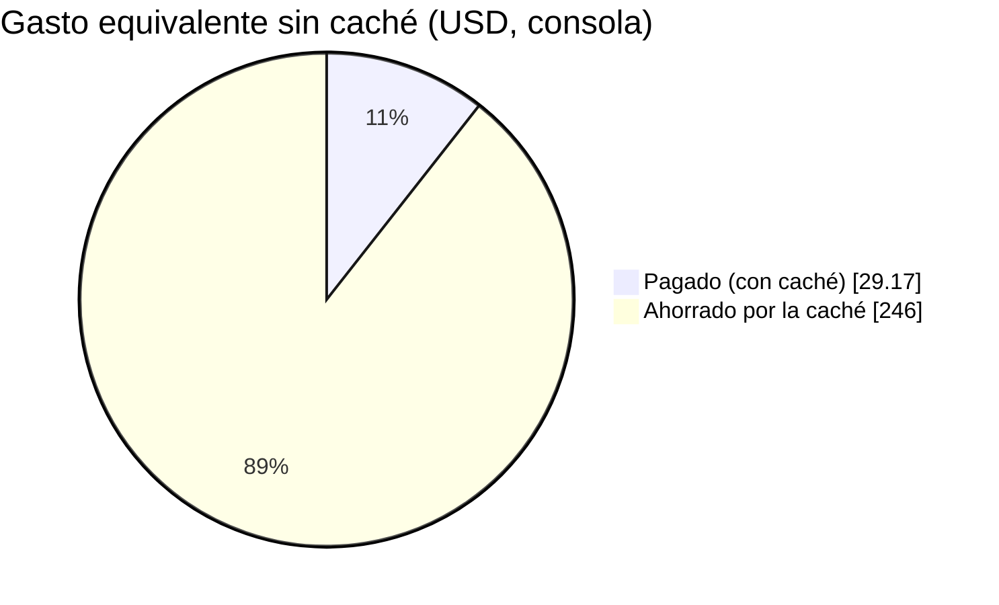
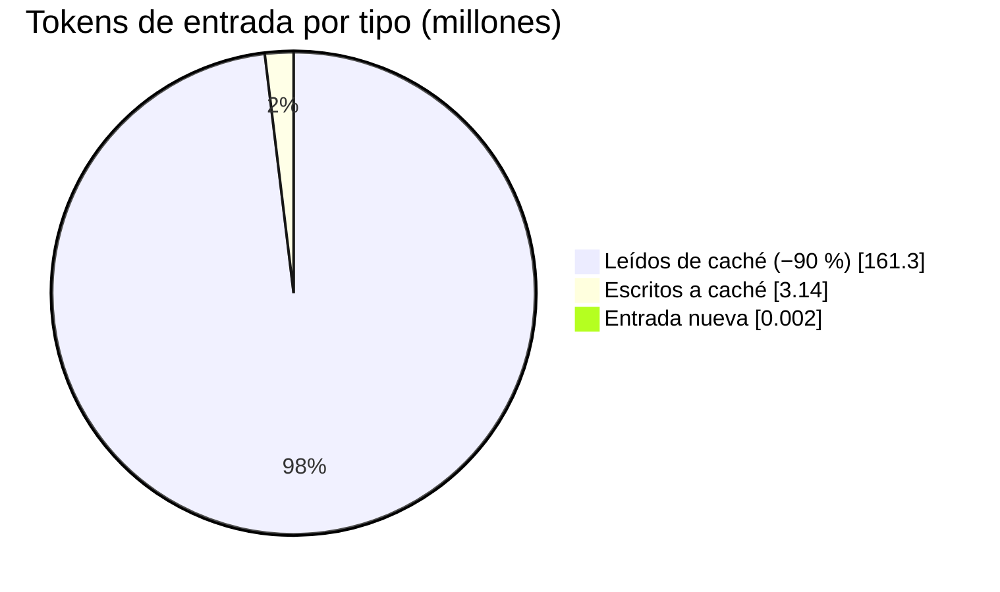

# Reporte de costos y ahorros

**Proyecto:** mus3o — Palacios de la Memoria 3D
**Actualizado:** 25 de octubre de 2026. Reemplaza la versión del 24 de octubre, que usaba tarifas de Sonnet 4.6 ($3/$15) en vez de las del modelo real.

## 1. Tarifas usadas

Precios de lista de la API de Anthropic (tabla de modelos consultada el 2026-10-06), en USD por millón de tokens (MTok):

| Modelo | Entrada | Salida | Lectura de caché | Escritura de caché |
|---|---|---|---|---|
| `claude-sonnet-5-5` (generación principal) | $2.00 | $10.00 | $0.20 | $2.50 *(derivado: 1,25× la entrada)* |
| `claude-haiku-5-5` (digest, Aris, respaldo 3D) | $0.10 (≤100K tokens) | $0.50 | $0.01 *(derivado: 0,1×)* | $0.125 *(derivado)* |

- La escritura de caché no figura en la tabla de precios; se calculó con el multiplicador habitual (1,25× entrada, 0,1× lectura). Confírmalo en la consola de facturación.
- Haiku 5.5 razona por defecto; el servidor lo apaga (`noThinking`), si no gastaba ~3.200 tokens de salida pensando.
- La recreación de una foto como diorama (`POST /api/diorama-from-image`, Sonnet 5.5 con visión) es un costo aparte por cuadro abierto; no está medido aquí.
- Elementos sin costo de tokens: búsqueda Poly Pizza, citas y retratos Wikimedia. ElevenLabs (voz) se factura aparte, por caracteres.

## 2. Qué cuesta un museo

Tokens medidos con el log `tokens` del servidor. Cuenta: `entrada × tarifa + salida × tarifa + caché`.

| Caso | Salida | Costo |
|---|---|---|
| **A. JSON monolítico** (formato antiguo, `FLOW_FORMAT=json`) | 10.925 | **~$0,117** |
| **B. DSL + diorama en llamada aparte** (referencia histórica) | 6.166 | **~$0,063** |
| **C. DSL + micro-DSL fusionado (actual), caché leída** | 3.514 | **~$0,036** |
| C con caché fría (primera generación de la ventana de 5 min) | 3.514 | ~$0,039 |
| Tema simple sin diorama (DSL ~1.850 tokens de salida) | ~1.850 | ~$0,019 |
| Apuntes largos (24.558 caracteres, 12 salas; 7.993 entrada, 5.046 salida, sin caché) | 5.046 | ~$0,066 |

Desglose del caso C: salida 3.514 × $10 = $0,0351; entrada 191 nuevos × $2 = $0,0004; caché 1.400 × $0,20 = $0,0003.

- **C frente a B (medición pareada, mismo tema):** −43 % de salida, unos −$0,027 por museo. Es la única comparación medida con el mismo tema.
- **C frente a A:** −69 %. Los temas y las fechas de medición son distintos, así que es orientativo.
- **Cuello de botella:** más del 98 % del costo es salida de Sonnet. La entrada y la caché pesan centavos de centavo.

Servicios secundarios, con Haiku 5.5 (estimaciones, sin medir):

| Servicio | Estimación por uso |
|---|---|
| Digest de apuntes (solo si superan `maxNotesChars`; 50K tokens de entrada, ≤6K de salida) | < $0,01 |
| Respaldo 3D en lote (≤500 tokens de salida) | ~$0,0003 |
| Ayuda de Aris (`max_tokens` 80, ~500 tokens de entrada supuestos) | ~$0,0001 |

## 3. Uso real: cuánto consumiría

Supuestos: caso C a ~$0,036 por museo generado y el resto de gastos despreciable. Una sesión de estudio es 1 museo más ~10 ayudas de Aris, ≈ $0,037.

| Escenario | Museos nuevos | Costo |
|---|---|---|
| Una persona probando | 1 | ~$0,04 |
| Una clase (30 alumnos, temas distintos) | 30 | ~$1,08 |
| Una clase, mismo tema | 1 (los demás comparten la generación en vuelo o la caché) | ~$0,04 |
| Demo de hackathon (100 museos) | 100 | ~$3,60 |
| Beta pública | 1.000 | ~$36 |
| 10.000 museos | 10.000 | ~$360 |
| **Tope diario del servidor** (`MAX_DAILY_GENERATIONS` = 200) | 200/día | **máx. ~$7,20/día** (~$13 si todos fueran apuntes largos) |

- **Acierto de caché:** si el 35 % de las solicitudes se repiten (supuesto, no medido) y salen de la caché de disco a $0, el costo baja un 35 %. Por ejemplo, 1.000 museos pasan de ~$36 a ~$23.
- **Sin las optimizaciones (caso A):** esos mismos 1.000 museos costarían ~$117, y 10.000 costarían ~$1.170.
- **Techo mensual:** con el tope de 200/día, el gasto máximo posible en IA es ~$216 al mes, aunque haya bots.

## 4. De dónde vienen los ahorros

1. **DSL compacto en vez de JSON con geometría:** el modelo elige y ordena, y el servidor construye el resto. Es la mayor palanca, de 10.925 a ~1.850 tokens.
2. **Diorama fusionado (micro-DSL `DIO`/`D_PROP`):** quita la llamada aparte, que gastó 2.825 tokens en la medición. Cuesta +173 tokens en la llamada principal. Esa llamada aparte ya no existe en `dev`: los dioramas científicos se quedaron sin generación por IA (usan la biblioteca o la foto).
3. **Prompt del sistema cacheado:** ~1.400 tokens leídos a $0,20 en vez de pagarlos a $2.
4. **Caché de disco/LRU y deduplicación en vuelo:** una solicitud repetida o simultánea cuesta $0.
5. **Haiku para tareas secundarias:** unas 20 veces más barato que Sonnet en entrada y salida.
6. **Modelos 3D por Poly Pizza (0 tokens):** hoy bloqueado por Cloudflare, así que todas las piezas usan el respaldo de Haiku. El costo del respaldo es despreciable, pero no hay ahorro de tokens en esa parte.

## 5. Ahorro real medido: caché de prompts al construir mus3o

Todo este ahorro sale de **construir mus3o** con un agente de código sobre la API de jrgil20: no es el costo de operar el producto (ese es el de las secciones 2 y 3). Viene de la **caché de prompts** (`cache_control`): los bloques largos y repetidos (instrucciones de sistema, `CLAUDE.md`, código leído, historial) se leen de la caché a **−90 %** frente a procesarlos como entrada normal.

### 5.1 Lo que dice la consola de Anthropic

| Métrica | Valor |
|---|---|
| Ahorro estimado por caché (últimos 7 días) | **~USD 246** |
| Tasa de aciertos de caché | **99 %** |
| Gasto real del mes en curso | **USD 29,17** |
| Gasto equivalente sin caché | **~USD 275+** |
| Tokens procesados (últimos 7 días) | 94,9 millones |

```
Sin caché   ████████████████████████████████████████  ~$275
Con caché   ████▎                                       $29,17
            └─ pagamos ~11 % de lo que habría costado: ahorro ≈ 89 %
```



### 5.2 Verificación con los registros de sesión de este repositorio

Para no depender solo de la consola, se sumó el uso (`usage`) de los 16 registros de sesión del agente guardados en este entorno, sin duplicados por mensaje (1.042 respuestas, del 24-oct 04:29 UTC al 25-oct 05:38 UTC, unas 25 h) y se valoró con las tarifas de la sección 1.

| Modelo | Respuestas | Entrada nueva | Escritura de caché | **Lectura de caché** | Salida | Costo real | Sin caché | **Ahorro** |
|---|---|---|---|---|---|---|---|---|
| Sonnet 5.5 | 734 | 1.500 | 2,05 M | **129,8 M** | 0,59 M | $37,02 | $269,67 | **$232,66** |
| Haiku 5.5 | 306 | 612 | 1,09 M | **31,5 M** | 0,26 M | $0,58 | $3,38 | **$2,81** |
| **Total** | 1.040 | ~2,1 mil | 3,14 M | **161,3 M** | 0,85 M | **$37,60** | **$273,06** | **$235,47** |

```
Tokens de entrada del agente (164,4 M)
Leídos de caché   ███████████████████████████████████████▎  98,1 %  (a −90 %)
Escritos a caché  ▊                                          1,9 %
Entrada nueva     ▏                                         ~0 %
```



- **Coincide con la consola:** ~$235 ahorrados y ~$273 sin caché en los registros, frente a ~$246 y ~$275+ en la consola; el 98 % de lecturas se parece al 99 % de aciertos. El gasto de los registros ($37,60) queda algo por encima de los $29,17 de la consola, lo esperable al valorar con tarifas de lista y una escritura de caché derivada (1,25×).
- **Dónde fue el gasto real ($37,60):** lecturas de caché ~$26,3 (70 %), salida ~$6,1 (16 %), escrituras de caché ~$5,3 (14 %), entrada nueva casi $0. Aun al −90 %, el volumen de lecturas domina.
- **Haiku casi gratis:** el 29 % de las respuestas salió de Haiku y costó $0,58 (1,5 % del gasto), siguiendo la regla de usar Haiku para todo lo que no sea lógica difícil.

### 5.3 Cómo se logró

1. **Prefijo estable que se reutiliza en cada turno:** el agente reenvía todo el contexto en cada paso; instrucciones, `CLAUDE.md` y lo ya leído se pagan una vez (escritura) y después se leen al 10 %.
2. **Contexto acotado:** leer por rango y con grep, no archivos enteros; assets binarios fuera del contexto (`.claudeignore`); ver `.claude/skills/token-budget`.
3. **Tareas ruidosas a un subagente barato:** tests y logs largos van al agente `test-runner` (Haiku), que devuelve un resumen y no llena el contexto principal.
4. **Modelo por tarea:** Sonnet solo para layout, servidor y bugs difíciles; Haiku para UI, docs, commits y tests simples (~20× más barato).
5. **Sesiones seguidas:** la caché dura 5 minutos; agrupar el trabajo evita reconstruirla (cada reconstrucción es una escritura de caché).

### 5.4 Cómo leer estas cifras

- La consola mide ahorro en 7 días y gasto en el mes en curso: el "~275+" es la suma de ambos, así que es orientativo.
- Los registros cubren solo las sesiones guardadas en este entorno; no incluyen un modelo Opus con 6 mil tokens de escritura y 15 mil de lectura (despreciable, tarifa no listada aquí).
- Las tarifas son las de lista de la sección 1; la escritura de caché es derivada. Si la consola difiere, manda la consola.

## 6. Límites de la medición

- Muestra pequeña: 2 museos nuevos, 1 pareado. Sirve para el orden de magnitud, no para fijar porcentajes.
- Latencia sin concluir: 45,0 s antes y 40,9 s ahora, ambas dominadas por el bloqueo de Poly Pizza. Repetir con red normal.
- Las tarifas pueden cambiar. Revisa la consola de facturación antes de presupuestar.
- Infraestructura: el plan Starter de Render cuesta $7/mes (dato del reporte anterior, no verificado aquí).
