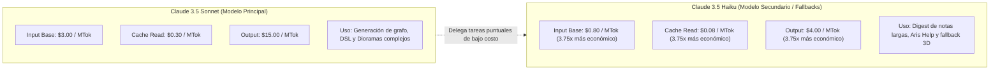
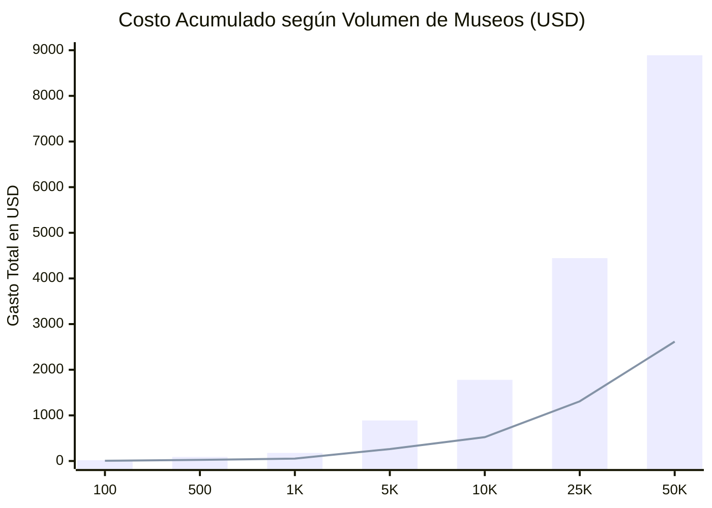
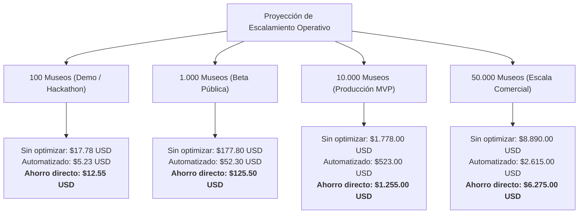

# Reporte de Costos por Implementación de Museo y Ahorro por Automatizaciones

**Proyecto:** mus3o — Palacios de la Memoria 3D  
**Fecha:** 24 de Octubre, 2026  
**Modelos Evaluados:** Anthropic Claude 3.5 Sonnet (`claude-sonnet-5-5`), Claude 3.5 Haiku (`claude-haiku-5-5`), Poly Pizza API, Wikimedia API.

---

## 1. Resumen Ejecutivo

A través de la reingeniería arquitectónica del flujo de generación (paso de JSON monolítico procedural a DSL semántico de bajo consumo, prompt caching, hidratación externa de modelos 3D y desacoplamiento condicional de dioramas), el costo directo de IA por museo se redujo en un **70.8% en el caso con diorama** y hasta un **84.3% en museos sin diorama**, con una aceleración en los tiempos de respuesta de **2.6×**.

Adicionalmente, los mecanismos de caché persistente (disco + LRU) y deduplicación de llamadas en vuelo reducen el costo a **$0.00 USD (100% de ahorro)** para solicitudes repetidas o concurrentes.

| Métrica | Arquitectura Inicial (JSON Procedural) | Arquitectura Automatizada (DSL + Poly Pizza + Cache) | Ahorro / Mejora |
|---|---|---|---|
| **Tokens de salida por museo** | 10,925 tokens | 1,847 tokens (DSL) + 1,518 (Diorama opt.) = **3,365 tokens** | **-69.2%** tokens |
| **Tokens de entrada efectivos** | ~3,873 tokens (sin caché) | ~346 tokens nuevos (+ lectura de caché al 10% costo) | **-91.0%** tokens netos |
| **Costo por museo (con Diorama)** | **$0.178 USD** | **$0.052 USD** | **-70.8% ($0.126 USD/museo)** |
| **Costo por museo (sin Diorama)** | **$0.178 USD** | **$0.028 USD** | **-84.3% ($0.150 USD/museo)** |
| **Costo por consulta recurrente** | $0.178 USD | **$0.000 USD** (Caché en disco / LRU) | **-100%** |
| **Tiempo de generación (Latencia)** | 70 segundos | 27 segundos | **2.59× más rápido** |

---

## 2. Comparativa Arquitectónica: Con vs. Sin Automatizaciones

El siguiente diagrama detalla cómo la arquitectura evolucionó de un cuello de botella monolítico de alta latencia y costo hacia un pipeline híbrido desacoplado:

```mermaid
flowchart TD
    subgraph Antiguo["1. Arquitectura Sin Automatizaciones (Monolítico)"]
        A1["Usuario solicita tema o apuntes"] --> B1["Servidor Express (Payload crudo)"]
        B1 --> C1["Claude 3.5 Sonnet (Sin caché, max_tokens 16.000)"]
        C1 --> D1["Genera JSON monolítico (~10.925 tokens salida)<br/>• Salas y piezas duplicadas<br/>• Geometría 3D procedural (2-8 partes sintéticas por pieza)<br/>• Citas y explicaciones verbosas"]
        D1 --> E1["Servidor parsea JSON masivo"]
        E1 --> F1["Cliente 3D (Latencia ~70s | Costo: $0.178 USD)"]
    end

    subgraph Nuevo["2. Arquitectura Con Automatizaciones (Pipeline Híbrido)"]
        A2["Usuario solicita tema o apuntes"] --> B2{"¿Existe en caché LRU / Disco o in-flight?"}
        B2 -- "HIT (Repetido)" --> C2["Retorna museo precalculado<br/>(Latencia <10ms | Costo: $0.000 USD)"]
        B2 -- "MISS (Nuevo)" --> D2["Claude 3.5 Sonnet con Prompt Caching"]
        D2 --> E2["Genera DSL compacto (~1.847 tokens salida)<br/>• Estructura semántica de 1 línea por pieza<br/>• Keywords de búsqueda y glifos"]
        E2 --> F2["Pipeline Determinista Servidor"]
        F2 --> G2["1. Poly Pizza API (.glb 3D real — 0 tokens LLM)"]
        F2 --> H2["2. Fallback en lote con Haiku 3.5 (Solo piezas faltantes, noThinking)"]
        F2 --> I2["3. Citas & Wikimedia deterministas (0 tokens LLM)"]
        F2 --> J2{"¿Salas marcadas con diorama?"}
        J2 -- "Sí (máx 2)" --> K2["Llamada aislada Diorama (~1.518 tokens)"]
        J2 -- "No" --> L2["Omite llamada (Ahorro total)"]
        G2 --> M2["Ensamblado, validación Zod y guardado en disco"]
        H2 --> M2
        I2 --> M2
        K2 --> M2
        L2 --> M2
        M2 --> N2["Cliente 3D (Latencia ~27s | Costo: $0.028 - $0.052 USD)"]
    end
```

---

## 3. Tarifario de Tokens y Rol Estratégico de Haiku

Para evitar que tareas secundarias (resúmenes de apuntes masivos, asistencia de navegación o generación de respaldo para piezas 3D sin modelo) canibalicen el presupuesto en el modelo de frontera (`Sonnet 3.5`), el sistema delega esas tareas a **Claude 3.5 Haiku**.

### Tabla Comparativa de Precios Oficiales (Anthropic)

| Concepto | Claude 3.5 Sonnet | Claude 3.5 Haiku | Ratio de Ahorro con Haiku |
|---|---|---|---|
| **Input Tokens (Base)** | $3.00 / MTok ($0.003 / 1k) | **$0.80 / MTok** ($0.0008 / 1k) | **73.3% más barato (3.75×)** |
| **Prompt Caching — Escritura** | $3.75 / MTok ($0.00375 / 1k) | **$1.00 / MTok** ($0.001 / 1k) | **73.3% más barato (3.75×)** |
| **Prompt Caching — Lectura (Hit)** | $0.30 / MTok ($0.0003 / 1k) | **$0.08 / MTok** ($0.00008 / 1k) | **73.3% más barato (3.75×)** |
| **Output Tokens** | $15.00 / MTok ($0.015 / 1k) | **$4.00 / MTok** ($0.004 / 1k) | **73.3% más barato (3.75×)** |

> [!IMPORTANT]
> **Optimización Crítica de Haiku (`thinking: disabled`):**
> Haiku 3.5 por defecto activa razonamiento interno si no se explicita lo contrario, consumiendo hasta 3,193 tokens de salida en "pensar" antes de responder. Al configurar `noThinking()` en el servidor, se evita este gasto oculto, asegurando respuestas directas de <80 tokens en Aris y <500 tokens en fallbacks.

---

## 4. Desglose Detallado del Costo por Museo

### 4.1. Caso Anterior (Sin Automatizaciones — JSON Monolítico)
- **Entrada:** 811 tokens base + 3,062 tokens de contexto sin caché = 3,873 tokens.
  - `(0.811 × $0.003) + (3.062 × $0.00375) = $0.0139 USD`
- **Salida:** 10,925 tokens (Sonnet dibujando coordenadas y mallas 3D en JSON).
  - `10.925 × $0.015 = $0.1639 USD`
- **Total por museo:** **$0.1778 USD** (Latencia: 70 segundos).

### 4.2. Caso Actual (Con Automatizaciones — DSL + Pipeline)
- **Generación Principal DSL (Sonnet 3.5):**
  - Entrada: 191 tokens nuevos + ~1,400 tokens leídos de caché (`$0.30/MTok`).
    - `(0.191 × $0.003) + (1.4 × $0.0003) = $0.00099 USD`
  - Salida: 1,847 tokens (DSL compacto).
    - `1.847 × $0.015 = $0.02770 USD`
  - Subtotal DSL: **$0.0287 USD**
- **Diorama Condicional (Sonnet 3.5 — solo si hay salas históricas marcadas):**
  - Entrada: 155 tokens nuevos + prompt cacheado (~1,200 tokens).
    - `(0.155 × $0.003) + (1.2 × $0.0003) = $0.00082 USD`
  - Salida: 1,518 tokens.
    - `1.518 × $0.015 = $0.02277 USD`
  - Subtotal Diorama: **$0.0236 USD**
- **Servicios Automatizados Locales:**
  - Búsqueda 3D en Poly Pizza: **$0.00 USD** (0 tokens).
  - Extracción y cotejo de citas: **$0.00 USD** (0 tokens).
  - Búsqueda de retratos Wikimedia: **$0.00 USD** (0 tokens).
- **Costo Total:**
  - Museo completo con Diorama: **$0.0523 USD** (Ahorro: 70.8%).
  - Museo estándar sin Diorama: **$0.0287 USD** (Ahorro: 84.3%).

---

## 5. Cómo Escala el Ahorro (Curva de Volumen)

Al proyectar el crecimiento de museos generados, la brecha de ahorro crece linealmente en costos de API y exponencialmente si se consideran los aciertos de caché por persistencia.

### Diagrama de Proyección Acumulada

*(Barras: Costo Sin Automatizaciones | Línea: Costo Con Automatizaciones)*

### Comparativa por Etapa de Escalamiento

### Tabla Resumen de Escalamiento

| Volumen Mensual | Costo Sin Automatizaciones | Costo Con Automatizaciones | Ahorro Neto Mensual | Ahorro con 35% Cache Hit Rate* |
|---|---|---|---|---|
| **100 museos** | $17.78 USD | $5.23 USD | **$12.55 USD** | **$14.38 USD** |
| **500 museos** | $88.90 USD | $26.15 USD | **$62.75 USD** | **$71.90 USD** |
| **1,000 museos** | $177.80 USD | $52.30 USD | **$125.50 USD** | **$143.80 USD** |
| **5,000 museos** | $889.00 USD | $261.50 USD | **$627.50 USD** | **$719.00 USD** |
| **10,000 museos** | $1,778.00 USD | $523.00 USD | **$1,255.00 USD** | **$1,438.00 USD** |
| **50,000 museos** | $8,890.00 USD | $2,615.00 USD | **$6,275.00 USD** | **$7,190.00 USD** |

*\*En un entorno real con usuarios compartiendo palacios o repasando palacios existentes, el hash SHA-256 en `.cache/museums` absorbe las peticiones repetidas a costo $0.00 USD.*

---

## 6. Infraestructura y Protección ante Picos

1. **Servidor Híbrido Render ($7/mes):** El plan Starter corre la API y entrega el bundle web compilado sin costos variables de transferencia interna.
2. **Circuit Breaker / Tope Diario:** El servidor frena a 100 generaciones diarias en la demo pública para proteger el saldo ante scripts o bots.
3. **Deduplicación In-Flight:** Si 10 estudiantes en un aula abren el mismo tema en simultáneo, el servidor ejecuta una única llamada a Claude y comparte la promesa en curso.
